<p align="center">
  
</p>

<p align="center"><code>&gt; you followed her in. good. this is what I build, and how.</code></p>

I build backend services in Go and iPhone apps in Swift and SwiftUI, and I spend as much
care on the checks around a system as on the system itself. I came to software through
security, where the habit of asking "how would I know if this were wrong?" was the whole
job. I kept the habit.

<p align="center">
  <code>Go</code> <code>Swift</code> <code>SwiftUI</code> <code>Python</code> <code>Kotlin</code> <code>Docker</code> <code>GitHub Actions</code> <code>Xcode</code>
</p>


**[Speed-to-lead](https://github.com/FawwazLawal/blaze-speed-to-lead)** · Python, FastAPI, Supabase, Discord

A lead-ad form submission becomes a scored, personalised reply in Discord a few seconds
later, against a 22-hour human baseline. One webhook, one database row, one structured
model call, one card. Three consecutive live runs measured end to end: 4.8s, 5.0s, 3.0s.

The part I care about is the honesty of the seam. Facebook itself is simulated, and the
README says exactly where simulation stops and real infrastructure starts. The model's reply
is parsed against a schema so a malformed response raises instead of reaching a human, and
the prompt is read from disk at runtime so the file in the repo is exactly what gets sent.



```
[01] A CHECK THAT CANNOT GO RED IS NOT A CHECK
```
`go test` without `-count=1` reads the cache. A mutation test of mine reported a pass on a
test that had never run, and 1 of 25 mutants came back falsely green. I now show a check
failing against the broken state before I trust it passing.

```
[02] DETECTORS STOP DEFECT CLASSES. RULES DO NOT.
```
Of thirteen recurring defect classes in my own build process, the only two that ever stopped
were stopped by an automated check, not by a rule everyone had agreed to. I build the
detector first.

```
[03] REPLACE THE PROXY WITH THE ACT
```
`git check-ignore` exits 0 when any pattern matches, including a negating one, so a perfectly
committable file reports as ignored. `git add --dry-run` is the operation itself. A check
should measure the thing you care about, not a predicate about it.

```
[04] AUDIT BY COMPUTATION, NOT BY EYE
```
I audited a design system for WCAG AA by computing the contrast ratios instead of trusting the
documented values. One token passed by 0.0008. Another failed outright and had zero usages,
so I deleted it rather than fixing it: an unused failing token is a trap for the next person.

```
[05] MEASURE BEFORE YOU CLAIM
```
"It builds" means it ran this session and exited 0. Every number says how it was measured.
Reading is a hypothesis, running is a finding, and I say which one I have.


My day-to-day development runs through a program of roughly thirty specialised Claude Code
agents: builders, QA, composition review, release. They coordinate over a file-based message
bus with lane ownership, a handoff protocol, and gated task promotion.

The agents were the easy part. The work was building the instruments that keep them honest:
detection for two agents about to write the same file, for gates that cannot fail, and for
records claiming more certainty than they have.


```
CREDENTIALS . B.S. Cybersecurity
               B.S. Electrical Engineering, in progress
               Security+ · CySA+ · PenTest+ · ISC2 Associate
```

<p align="center">
  
</p>

<p align="center"><sub>Every scene on this page is an SVG generated by code in <a href="./gen">gen/</a>, animated with SMIL, no scripts, no external assets.</sub></p>
