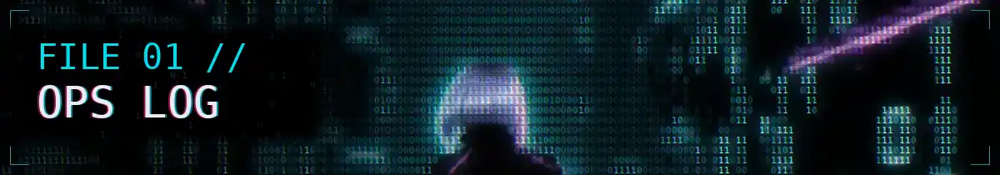
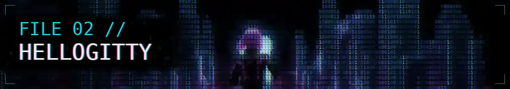
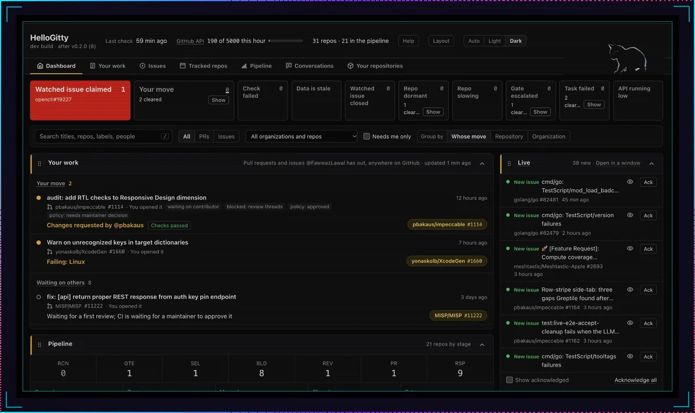
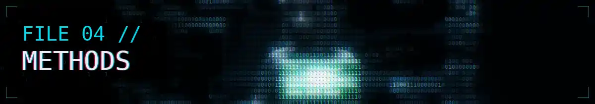
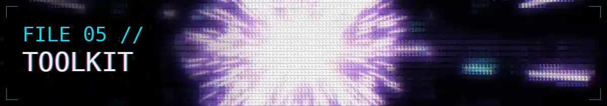
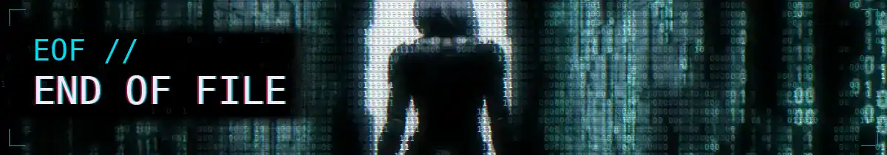

<!-- Tier 3, art-directed (docs/design/adr-readme-design-language.md). Evidence dossier: the files run from the most checkable evidence to the least. UPSTREAM and ACTIVITY are rewritten daily by gen/stats_cards.py; the bands come from gen/title_cards.py. -->

<picture>
  <source media="(prefers-reduced-motion: reduce)" srcset="./assets/bands/hero-still.webp">
  
</picture>

# Fawwaz Lawal

I'm a software engineer who builds backend services in Go and native apps in Swift, and I came to software through security.

In security the whole job was asking *how would I know if this were wrong?* I kept the habit, so this page is filed like evidence. Each file says where its proof lives, and the files run from the most checkable to the least:

1. **[Ops log](#file-01-ops-log-of-my-upstream-pull-requests)**: every pull request I've opened on someone else's project and where it stands, rebuilt daily from GitHub. **[GENERATED]**
2. **[HelloGitty](#file-02-hellogitty-the-public-tool-behind-the-log)**: the public tool I track that work with. Install it and look. **[LINKED]**
3. **[Restricted](#file-03-restricted-two-private-products-declassified)**: two private products, in captures and in figures I counted. **[SHOWN]** **[STATED]**
4. **[Methods](#file-04-methods-or-how-i-check-my-own-work)** and **[toolkit](#file-05-toolkit-and-credentials-as-stated)**: how I check my work and what I work with, in my own words. **[STATED]**

<sub>**[GENERATED]** written by a script in this repository, and dated · **[LINKED]** public, one click away · **[SHOWN]** a capture, which proves the software exists, not how well it works · **[STATED]** self-reported from my own records and dated: my word, not a link.</sub>

<picture>
  <source media="(prefers-reduced-motion: reduce)" srcset="./assets/bands/file-01-still.webp">
  
</picture>

## File 01: Ops log of my upstream pull requests

**I send fixes upstream to tools I use, mostly security tooling (OpenCTI, MISP, Coraza), plus XcodeGen, the `go test` help text and impeccable's hardening and audit guides.** Each row opens the pull request itself, where the review is public. Open means open: the state column comes from GitHub, not from me.

<!-- UPSTREAM:START -->
| State | Pull request |
|---|---|
| `MERGED` | [fix(ui): fix SMTP configuration margin and empty value display (#18931)](https://github.com/OpenCTI-Platform/opencti/pull/19110)<br><sub>OpenCTI-Platform/opencti #19110 · opened 2026-10-20 · merged 2026-10-23</sub> |
| `OPEN` | [Warn on unrecognized keys in target dictionaries](https://github.com/yonaskolb/XcodeGen/pull/1660)<br><sub>yonaskolb/XcodeGen #1660 · opened 2026-10-23</sub> |
| `OPEN` | [audit: add RTL checks to Responsive Design dimension](https://github.com/pbakaus/impeccable/pull/1114)<br><sub>pbakaus/impeccable #1114 · opened 2026-10-22</sub> |
| `MERGED` | [Add Arabic-script specifics to hardening reference (#1009)](https://github.com/pbakaus/impeccable/pull/1084)<br><sub>pbakaus/impeccable #1084 · opened 2026-10-19 · merged 2026-10-21</sub> |
| `OPEN` | [fix(ui): separate indicator list column values in the Knowledge tab (#18163)](https://github.com/OpenCTI-Platform/opencti/pull/19154)<br><sub>OpenCTI-Platform/opencti #19154 · opened 2026-10-21</sub> |
| `OPEN` | [cmd/go: clarify test cache behavior for file metadata](https://github.com/golang/go/pull/82377)<br><sub>golang/go #82377 · opened 2026-10-20</sub> |
| `OPEN` | [fix: \[api\] return proper REST response from auth key pin endpoint](https://github.com/MISP/MISP/pull/11222)<br><sub>MISP/MISP #11222 · opened 2026-10-20</sub> |
| `OPEN` | [docs: document skip/skipAfter limitations under multiphase evaluation (#804)](https://github.com/corazawaf/coraza/pull/1785)<br><sub>corazawaf/coraza #1785 · opened 2026-10-19</sub> |
| `OPEN` | [fix(ui): align info icon tooltips in user creation form (#19017)](https://github.com/OpenCTI-Platform/opencti/pull/19108)<br><sub>OpenCTI-Platform/opencti #19108 · opened 2026-10-19</sub> |
| unconfirmed | [Fix gzip Accept-Encoding quality parameter handling](https://github.com/hapifhir/hapi-fhir/pull/8530)<br><sub>hapifhir/hapi-fhir #8530 · opened 2026-10-19 · state could not be confirmed on 2026-10-24</sub> |
| `CLOSED` | [test: port PySpark Catalog.listFunctions doctest](https://github.com/lakehq/sail/pull/2821)<br><sub>lakehq/sail #2821 · closed without merge</sub> |

<sub>Seeded by hand on 2026-10-24 from a check of each pull request. From the next daily run, <a href="./gen/stats_cards.py">gen/stats_cards.py</a> rewrites this log from GitHub's API and stamps it **[GENERATED]**. 2 merged · 7 open · 1 unconfirmed · 1 closed without merge. Practice repositories are left out.</sub>
<!-- UPSTREAM:END -->

<details>
<summary><b>Field notes: what each change does</b></summary>

- **OpenCTI**, the threat intelligence platform: toggle margins and empty values in the SMTP configuration form; info-icon tooltips aligned on the user creation form; indicator list cells given a definite width so long values stop running into the next column.
- **MISP**: `POST /auth_keys/pin/:id` answers API callers with a JSON success or failure response instead of a Flash message.
- **Coraza**: a README warning and a doc comment on how `skip`, `skipAfter` and `allow` behave under the multiphase evaluation build tag.
- **Go**: the `go test` help text now says the test result cache checks file metadata (modification time, size), not file content. It updates golang/go#35301.
- **XcodeGen**: a spec validation warning for unrecognised keys in a target dictionary, to catch typos such as `resources` for `sources`.
- **impeccable**: Arabic-script specifics for the hardening guide (ZWNJ preservation, Persian and Arabic Yeh and Kaf, locale-aware digits and calendars through `Intl`), and audit checks that flag physical CSS properties on right-to-left pages.
- **HAPI FHIR**: the server honours the `q` value on gzip in `Accept-Encoding`, so `gzip;q=0` turns gzip off.
- **Sail**: a port of PySpark's `Catalog.listFunctions` doctest. It was closed without merge.

<sub>Hand-written, so they carry no states. The log above is the record.</sub>

</details>

<picture>
  <source media="(prefers-reduced-motion: reduce)" srcset="./assets/bands/file-02-still.webp">
  
</picture>

## File 02: HelloGitty, the public tool behind the log

<sub>**[LINKED]** [FawwazLawal/hellogitty](https://github.com/FawwazLawal/hellogitty) · Go · MIT licence · v0.2.0, released 2026-10-23</sub>

**HelloGitty is a local dashboard for open source work: every pull request and issue you have out on GitHub, sorted by whose move it is, beside the health of the projects you follow.** I built it to run the work in File 01. It's the one project on this page you can install and check for yourself.

<picture>
  <source media="(prefers-color-scheme: light)" srcset="./assets/work/hellogitty-light.webp">
  
</picture>

<sub>**[LINKED]** My own instance, captured in each theme; GitHub shows the one that matches yours. The pull requests under *Your move* are rows from File 01, as they stood at capture.</sub>

- **Polls, then stores.** HelloGitty polls the GitHub API on a schedule, hourly by default, and keeps everything in SQLite.
- **One local page.** A single self-contained page on localhost, with no build step, no CDN and no external fonts, so it works offline once the data is local.
- **A snapshot for scripts.** Each poll writes `snapshot.json`, so anything downstream reads what the last sweep found instead of scraping the page.
- **One file to configure.** Settings live in one JSON file, and [the guide](https://github.com/FawwazLawal/hellogitty/blob/main/docs/GUIDE.md) explains every column, colour and cell.

```sh
go install github.com/FawwazLawal/hellogitty/cmd/hellogitty@latest
```

It needs Go 1.26 or newer and a read-only GitHub token. [The quick start](https://github.com/FawwazLawal/hellogitty#quick-start) takes it from there.

**Status:** v0.2.0, released 2026-10-23. Proven: it runs, and the capture is my own instance tracking 31 repositories. Not yet shown: anyone using it but me.

<picture>
  <source media="(prefers-reduced-motion: reduce)" srcset="./assets/bands/file-03-still.webp">
  
</picture>

## File 03: Restricted, two private products declassified

**The two projects I spend most of my time on live in private repositories, so this file shows the work without the source.** Captures are stamped **[SHOWN]**: they prove the software exists, not how well it works. Figures are stamped **[STATED]**: I counted and dated them, and you have my word for them, not a link.

<!-- ACTIVITY:START -->
<sub>**[GENERATED]** 2026-10-24 from GitHub's API: 2,375 contributions in the past year, 2,189 of them in private repositories.</sub>
<!-- ACTIVITY:END -->

### Fisher: the Internet Archive's audio as a music app

<sub>**[SHOWN]** Private repository · Swift, SwiftUI and Go · in development, not in any app store</sub>

An iPhone client and a Go backend for the Internet Archive's public audio: a century of concerts, broadcasts and records, much of it absent from streaming services. Playback is the easy part. The work is making an archive this large and this uncurated feel like a music app.


<sub>**[SHOWN]** Three screens from the private build: home, a mix built by rule, and now playing with the note on the recording.</sub>

Mixes are built by rule, not by hand, and each one states the rule it was built from. *Hip Hop Essentials* is "tagged hip hop or rap, most downloaded this week, one record an artist, from artists a music database knows." The cover is a mosaic of the records that made the cut. The home feed reorders from listening behaviour, with artist affinity and genre weighting that decay over time, computed entirely on-device. The player carries a written note on the recording itself, so a 1992 record arrives with its history attached rather than as a bare file name.

**Status:** in development, not in any app store. Built: a Go API with background workers, a SwiftUI client with a widget extension, and unit and UI test targets. **[STATED]** 629 commits, as first recorded on this page on 2026-10-16.

### Domain Dispatch: field operations where the network drops

<sub>**[SHOWN]** Private repository · Swift, SwiftUI, Vapor and Kotlin · alpha</sub>

A multi-modal field operations platform for teams that work where connectivity ends. It fuses drones, vehicles, traffic cameras, aircraft, weather and mesh radios into one operational picture, with mission tasking, event dispatch and review workflows: macOS and iOS in Swift and SwiftUI, a Vapor service, and an Android companion. It is offline-first because it has to work at a trailhead with no signal, and that drives nearly every architectural decision.


<sub>**[SHOWN]** Owned assets and public traffic cameras on one map, with a camera feed open in place. **Redacted:** the basemap is blurred and the camera's agency badge obscured, because the console is pointed at a real place.</sub>

Everything assumes the link will drop: offline map packs, a sync queue that drains when the connection returns, and a status bar that stays honest about what is connected and what is not.


<sub>**[SHOWN]** Mission planning: area, assets, flight parameters, classification, geofence and operator must all be set before Begin Mission.</sub>

Planning is a checklist with teeth. An area of operations is drawn on the map, searched by address, or taken from the current view, and plans save and replay. Interop is first party: Cursor-on-Target over an embedded TAK relay, MQTT, HLS video, and multi-source fusion with explicit conflict resolution when two sources disagree about the same entity.

**The failure worth designing for is the invisible one.** An elevation lookup was caching network failures as "no data", so an operator could plan offline, reconnect, and never get the terrain warning back. The fix separates *checking* from *could not check* from *no conflict*, because an absent answer that renders as "clear" fails in the dangerous direction. The same reasoning made the terrain lookup opt-in: it sends planned search area coordinates to a third party, and that is an operator's decision, not a default.

**Status:** alpha; the last recorded tag is v0.193.0-alpha (2026-10-16). This page makes no claim of field deployment.

<details>
<summary><b>Declassify: twelve figures from the private repository</b></summary>

| Figure | Count |
|---|--:|
| Commits | 1,497 |
| Tagged releases | 189 |
| Latest tag | v0.193.0-alpha |
| Swift modules | 7 |
| Source files | 345 |
| Third-party runtime dependencies | none |
| Test files | 455 |
| Tests | about 3,600 |
| Automated quality gates | 44 |
| Self-tests whose only job is to prove a gate fails when it should | 27 |
| Engineering incidents logged with a root cause | 550 |
| Architecture decisions recorded | 131 |

<sub>**[STATED]** First recorded on this page on 2026-10-16, from the private repository. No counting method is published, so read these as my record, not as measurements you can repeat.</sub>

</details>

<picture>
  <source media="(prefers-reduced-motion: reduce)" srcset="./assets/bands/file-04-still.webp">
  
</picture>

## File 04: Methods, or how I check my own work

<sub>**[STATED]** Notes from my own build process on private projects. The numbers are mine and aren't linked; the one public trace is.</sub>

**I trust a check only after I've seen it fail.** Five notes on why:

**A check that cannot go red is not a check.** A mutation test of mine reported a pass on a test that had never run: `go test ./...` without `-count=1` can replay a cached pass, and 1 of 25 mutants came back falsely green. I now show a check failing against the broken state before I trust it passing. The public trace is [golang/go#82377](https://github.com/golang/go/pull/82377), still open: my change to the `go test` help text, saying the cache checks file metadata, not content.

**Detectors stop defect classes. Rules do not.** Of thirteen recurring defect classes in my own build process, the only two that ever stopped were stopped by an automated check, not by a rule everyone had agreed to. I build the detector first.

**Replace the proxy with the act.** `git check-ignore -v` exits 0 when any pattern matches, including a negating one, so a perfectly committable file reports as ignored. `git add --dry-run` is the operation itself. A check should measure the thing you care about, not a predicate about it.

**Audit by computation, not by eye.** I audited a design system for WCAG AA by computing the contrast ratios instead of trusting the documented values. One token passed by 0.0008. Another failed outright and had zero usages, so I deleted it rather than fixing it: an unused failing token is a trap for the next person.

**Measure before you claim.** "It builds" means it ran this session and exited 0. Every number says how it was measured. Reading is a hypothesis, running is a finding, and I say which one I have.

### Agents, and the instruments that keep them honest

My day-to-day development runs through roughly thirty specialised Claude Code agents: builders, QA, composition review, release. The agents were the easy part. The work was building the instruments that keep them honest: detection for two agents about to write the same file, for gates that cannot fail, and for records claiming more certainty than they have.

<picture>
  <source media="(prefers-reduced-motion: reduce)" srcset="./assets/bands/file-05-still.webp">
  
</picture>

## File 05: Toolkit and credentials, as stated

<sub>**[STATED]** No verification links are published for these. Go, Python and GitHub Actions can be checked in public code: HelloGitty, and the [generators behind this page](./gen).</sub>

- **Languages:** Go · Swift · Python · Kotlin
- **Apple platforms:** SwiftUI · Xcode
- **Delivery:** Docker · GitHub Actions
- **Security work upstream:** OpenCTI · MISP · Coraza, logged in [File 01](#file-01-ops-log-of-my-upstream-pull-requests)
- **Education:** B.S. Cybersecurity · B.S. Electrical Engineering, in progress
- **Certifications:** Security+ · CySA+ · PenTest+ · ISC2 Associate

## Check the record yourself

Nothing on this page asks for more trust than its stamp. To check the rest:

- **The pull requests:** every row in [File 01](#file-01-ops-log-of-my-upstream-pull-requests) opens the pull request on its own project, with its review history.
- **The code:** [HelloGitty](https://github.com/FawwazLawal/hellogitty), and my [other public repositories, with forks hidden](https://github.com/FawwazLawal?tab=repositories&type=source).
- **This page:** the film, the captures, the ops log and the activity line all come from [scripts in this repository](./gen).

<details>
<summary><b>How this page is built</b></summary>

- **The film.** Three clips generated with Google Flow, cut together and rendered into 0 and 1 glyphs frame by frame by [gen/ascii_film.py](./gen/ascii_film.py). The bands are short loops from the same footage. [gen/title_cards.py](./gen/title_cards.py) redraws their titles at a size a phone can read and writes the still shown when your system asks for reduced motion. The title band plays once and holds; the [full 15.6-second film](./assets/originals/hero-band.webp) (5 MB) plays when you open it.
- **The captures.** Framed by [gen/work_shots.py](./gen/work_shots.py). Location detail in the operations captures is blurred before framing.
- **The ops log and the activity line.** Rewritten every day by [gen/stats_cards.py](./gen/stats_cards.py) from GitHub's public API, in [a scheduled workflow](./.github/workflows/stats.yml). A failed run leaves the last version in place, with its old date.

</details>

<picture>
  <source media="(prefers-reduced-motion: reduce)" srcset="./assets/bands/end-still.webp">
  
</picture>
