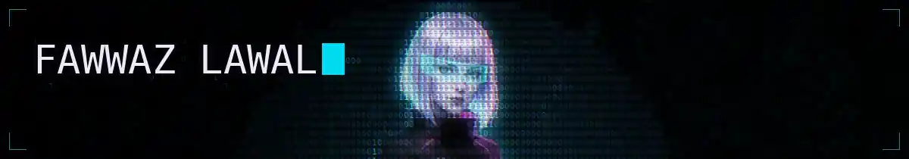
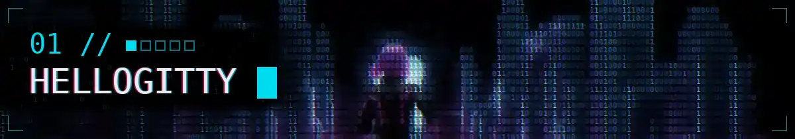
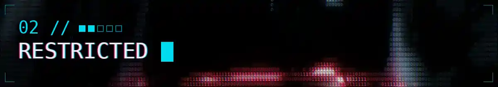
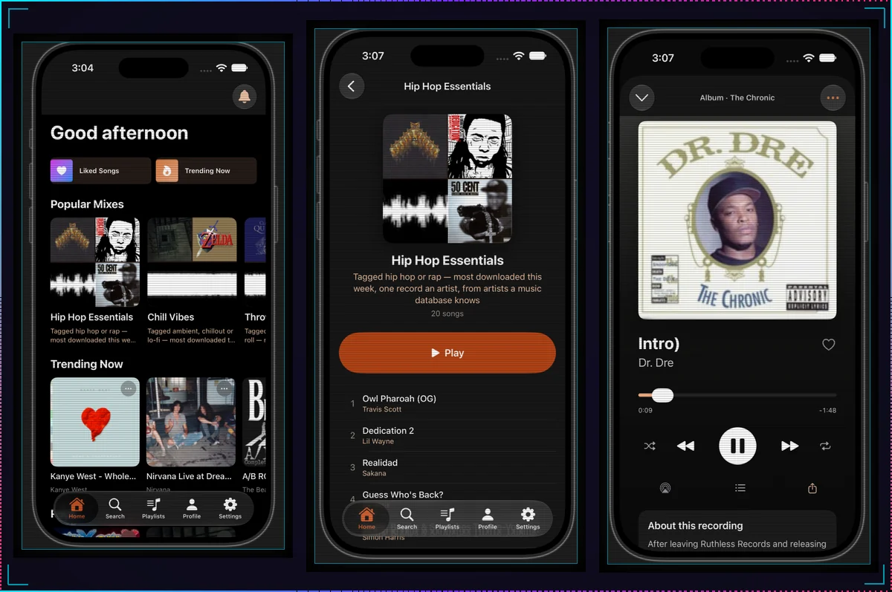
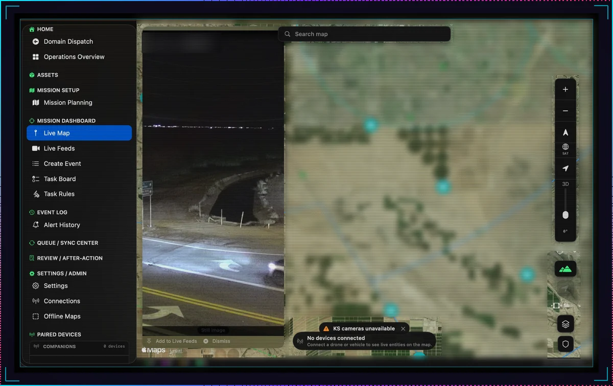
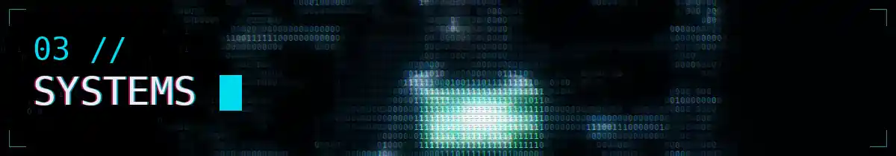
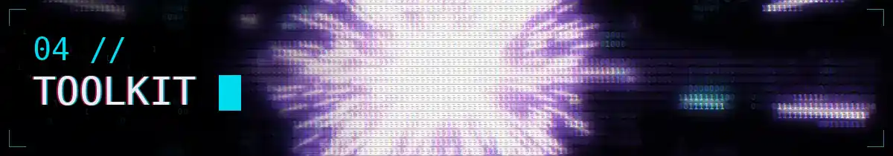
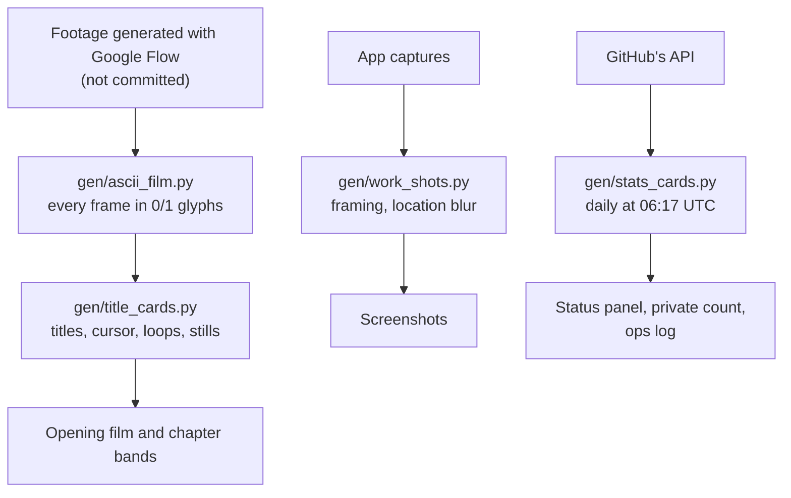

<!-- Tier 3, art-directed (docs/design/adr-readme-design-language.md). Bands come from gen/title_cards.py.
The STATS, ACTIVITY and UPSTREAM blocks are rewritten daily by gen/stats_cards.py: change the generator, not the block. -->

<a href="./assets/bands/film.webp" title="Play the uncut 15.7-second film">
<picture>
  <source media="(prefers-reduced-motion: reduce)" srcset="./assets/bands/hero-still.webp">
  
</picture>
</a>

# Fawwaz Lawal

I build backend services in Go and native apps in Swift and SwiftUI. I came to software
through security, where the job was asking *"how would I know if this were wrong?"*, and I
kept the habit: I put as much care into the checks around a system as into the system. So this
page runs from the most checkable evidence to the least:

1. **[Ops log](#00--ops-log-my-pull-requests-to-other-peoples-projects)**: every pull request I've opened on someone else's project and where it stands, rebuilt daily from GitHub. <code>GENERATED</code>
2. **[HelloGitty](#01--hellogitty-the-public-tool-behind-the-log)**: the public tool I track that work with. Install it and look. <code>PUBLIC</code>
3. **[Restricted](#02--restricted-two-private-projects)**: two private products, in screenshots and in figures I counted. <code>SHOWN</code> <code>STATED</code>
4. **[Systems](#03--systems-how-i-work)** and **[toolkit](#04--toolkit-what-i-work-with)**: how I check my work and what I work with, in my own words. <code>STATED</code>

<sub><code>PUBLIC</code> one click to check · <code>GENERATED</code> written daily from GitHub's API by a script in this repository, and dated · <code>SHOWN</code> a screenshot: it proves the software exists, not how well it works · <code>STATED</code> my word, dated where it changes</sub>

## 00 · Ops log: my pull requests to other people's projects

<code>GENERATED</code> <sub>rebuilt daily from GitHub's API ·</sub> <code>PUBLIC</code> <sub>each row opens the pull request and its review so far</sub>

**I send fixes upstream, most often to impeccable, the design tool I use most: its hardening
and audit guides. Beyond that: security tooling (OpenCTI, MISP, Coraza), XcodeGen, and Go's
`go test` help text.** Open means open: the state column comes from GitHub, not from me.

<!-- UPSTREAM:START -->
| State | Pull request |
|---|---|
| `MERGED` | [fix(ui): fix SMTP configuration margin and empty value display (#18931)](https://github.com/OpenCTI-Platform/opencti/pull/19110)<br><sub>OpenCTI-Platform/opencti #19110 · opened 2026-10-20 · merged 2026-10-23</sub> |
| `MERGED` | [Add Arabic-script specifics to hardening reference (#1009)](https://github.com/pbakaus/impeccable/pull/1084)<br><sub>pbakaus/impeccable #1084 · opened 2026-10-19 · merged 2026-10-21</sub> |
| `OPEN` | [Warn on unrecognized keys in target dictionaries](https://github.com/yonaskolb/XcodeGen/pull/1660)<br><sub>yonaskolb/XcodeGen #1660 · opened 2026-10-23</sub> |
| `OPEN` | [audit: add RTL checks to Responsive Design dimension](https://github.com/pbakaus/impeccable/pull/1114)<br><sub>pbakaus/impeccable #1114 · opened 2026-10-22</sub> |
| `OPEN` | [fix(ui): separate indicator list column values in the Knowledge tab (#18163)](https://github.com/OpenCTI-Platform/opencti/pull/19154)<br><sub>OpenCTI-Platform/opencti #19154 · opened 2026-10-21</sub> |
| `OPEN` | [cmd/go: clarify test cache behavior for file metadata](https://github.com/golang/go/pull/82377)<br><sub>golang/go #82377 · opened 2026-10-20</sub> |
| `OPEN` | [fix: \[api\] return proper REST response from auth key pin endpoint](https://github.com/MISP/MISP/pull/11222)<br><sub>MISP/MISP #11222 · opened 2026-10-20</sub> |
| `OPEN` | [fix(ui): align info icon tooltips in user creation form (#19017)](https://github.com/OpenCTI-Platform/opencti/pull/19108)<br><sub>OpenCTI-Platform/opencti #19108 · opened 2026-10-19</sub> |
| `OPEN` | [docs: document skip/skipAfter limitations under multiphase evaluation (#804)](https://github.com/corazawaf/coraza/pull/1785)<br><sub>corazawaf/coraza #1785 · opened 2026-10-19</sub> |
| `CLOSED` | [test: port PySpark Catalog.listFunctions doctest](https://github.com/lakehq/sail/pull/2821)<br><sub>lakehq/sail #2821 · opened 2026-10-21 · closed without merging</sub> |
| `CLOSED` | [Fix Accept-Encoding quality parameter handling for gzip](https://github.com/hapifhir/hapi-fhir/pull/8530)<br><sub>hapifhir/hapi-fhir #8530 · opened 2026-10-20 · closed without merging</sub> |

<sub><code>GENERATED</code> 2026-10-25 from GitHub's API by <a href="./gen/stats_cards.py">gen/stats_cards.py</a>: 2 merged · 7 open · 2 closed without merging. Practice repositories are left out. Go merges through Gerrit, so a Go pull request counts as merged when Gerrit's bot says so. If a daily run fails, this date stops moving.</sub>
<!-- UPSTREAM:END -->

<details>
<summary><b>Field notes: what each change does</b></summary>

- **impeccable** · [Add Arabic-script specifics to hardening reference](https://github.com/pbakaus/impeccable/pull/1084). Merged: the hardening guide now covers Arabic-script text: keep zero-width non-joiners, handle the Persian and Arabic forms of Yeh and Kaf, and format digits and calendars by locale.
- **impeccable** · [audit: add RTL checks to Responsive Design dimension](https://github.com/pbakaus/impeccable/pull/1114). Adds right-to-left checks to the audit's responsive score: on pages declared RTL, physical CSS such as `margin-left` becomes something to verify in the render, with the cases where it is still correct.
- **Go** · [`cmd/go`: clarify test cache behavior for file metadata](https://github.com/golang/go/pull/82377). Documents that, for files a test opens, the test cache checks size and modification time, not content.
- **XcodeGen** · [Warn on unrecognized keys in target dictionaries](https://github.com/yonaskolb/XcodeGen/pull/1660). Warns about a mistyped target key, such as `resources` for `sources`, instead of ignoring it.
- **Coraza** · [Document skip/skipAfter limitations under multiphase evaluation](https://github.com/corazawaf/coraza/pull/1785). Documents how `skip`, `skipAfter` and `allow` can leave a variable uninspected in the firewall's multiphase mode.
- **MISP** · [Return proper REST response from auth key pin endpoint](https://github.com/MISP/MISP/pull/11222). Makes the endpoint answer API callers with JSON instead of a browser flash message.
- **OpenCTI** · [Fix SMTP configuration margin and empty value display](https://github.com/OpenCTI-Platform/opencti/pull/19110). Merged: an empty setting shows the platform's plain dash instead of a dash in a chip.

</details>

<picture>
  <source media="(prefers-reduced-motion: reduce)" srcset="./assets/bands/chapter-01-hellogitty-still.webp">
  
</picture>

## 01 · HelloGitty: the public tool behind the log

<code>PUBLIC</code> <sub><a href="https://github.com/FawwazLawal/hellogitty">FawwazLawal/hellogitty</a> · Go · SQLite · Special Licence · <a href="https://github.com/FawwazLawal/hellogitty/releases/latest">v0.2.0 (8)</a>, tag <code>v0.2.8</code>, released 2026-10-23</sub>

**HelloGitty is a local dashboard for open-source work: every pull request and issue you have
out on GitHub, sorted by whose move it is, beside the health of the projects you follow.** I
built it to run the work in the ops log, and it's the one project on this page you can install
and check for yourself. It polls GitHub hourly into SQLite and serves a self-contained page on `localhost`: no build
step, no CDN, and it works offline.


<p align="center"><sub><i>My own instance, a dev build after v0.2.0 (8), in both of its themes. Its pipeline counts match the ops log above: 7 open, 2 merged, 2 closed.</i></sub></p>

```sh
go install github.com/FawwazLawal/hellogitty/cmd/hellogitty@latest
```

**Status:** public; needs Go 1.26+ and a GitHub token ([quick start](https://github.com/FawwazLawal/hellogitty#quick-start)).
Proven: it runs, and its tests run before every tagged release ([workflow](https://github.com/FawwazLawal/hellogitty/blob/main/.github/workflows/release.yml)).
Not yet shown: anyone using it but me.

<picture>
  <source media="(prefers-reduced-motion: reduce)" srcset="./assets/bands/chapter-02-restricted-still.webp">
  
</picture>

## 02 · Restricted: two private projects

<code>SHOWN</code> <sub>screenshots ·</sub> <code>STATED</code> <sub>descriptions and figures, dated · source private</sub>

The source is private, so this chapter shows the apps and marks every number as my word.
GitHub counts the work without showing it:

<!-- ACTIVITY:START -->
<code>GENERATED</code> 2026-10-25 from GitHub's API: **2,308 of my 2,580** contributions in the past year were in private repositories.
<!-- ACTIVITY:END -->

### Fisher: the Internet Archive's audio as a music app

<code>SHOWN</code> <sub>iPhone app · Swift · SwiftUI · Go backend · in development</sub>

An iPhone app and Go backend that make audio hosted on the Internet Archive feel like a music
app: mixes built by stated rules, a home feed that learns from listening on the device, and a
note on each recording's history.



**Status:** in development, not in any app store; <code>STATED</code> 629 commits as of
2026-10-16. Pictured: the iPhone app.

### Domain Dispatch: field operations where the network drops

<code>SHOWN</code> <sub>macOS app · Swift · SwiftUI · Vapor · Kotlin · alpha</sub>

One live map for teams working where connectivity ends: drones, vehicles, traffic cameras,
aircraft, weather and mesh radios, with mission planning and dispatch. Offline-first: map
packs, a sync queue that drains on reconnect, and a status bar that says what is connected.
It speaks Cursor-on-Target over an embedded TAK relay, MQTT and HLS.


<p align="center"><sub><i>The basemap is blurred, and the camera's agency badge and state obscured, because the console is pointed at a real place.</i></sub></p>

**The failure worth designing for is the invisible one.** An elevation lookup cached network
failures as "no data", so an operator could plan offline, reconnect, and never get the terrain
warning back. The fix separates *checking* from *could not check* from *no conflict*: an absent
answer that renders as "clear" fails in the dangerous direction. The lookup also sends planned
coordinates to a third party, so it is opt-in.

**Status:** alpha; <code>STATED</code> v0.193.0-alpha as of 2026-10-16. Pictured: the macOS
app; the iOS app, Vapor service and Android companion are not. No claim of field use.

<details>
<summary><b>Declassify the repository figures</b> · <code>STATED</code> 2026-10-16</summary>

| Domain Dispatch, private repository | Count |
|---|--:|
| Commits | 1,497 |
| Tests | about 3,600 |
| Automated quality gates | 44 |
| Self-tests that prove a gate fails when it should | 27 |

<sub>Counted from the private repository on 2026-10-16. No counting method is published, so read these as my record.</sub>

</details>

<picture>
  <source media="(prefers-reduced-motion: reduce)" srcset="./assets/bands/chapter-03-systems-still.webp">
  
</picture>

## 03 · Systems: how I work

<code>STATED</code> <sub>from my own build notes ·</sub> <code>PUBLIC</code> <sub>one pull request and one command you can run</sub>

**A check that cannot go red is not a check.** A mutation test of mine passed a test that
never ran against the mutant: `go test` without `-count=1` can replay a cached result. I now
watch a check fail against the broken state before I trust it to pass.
[My Go pull request](https://github.com/golang/go/pull/82377) is the public trace.

**Detectors stop defect classes. Rules do not.** Of thirteen recurring defect classes in my
build process, the only two that stopped were stopped by an automated check. I build the
detector first.

**Replace the proxy with the act.** `git check-ignore -v` exits 0 even for a file a negated
rule keeps; `git add --dry-run` is the operation itself:

```console
$ git check-ignore -v keep.log; echo "exit $?"
.gitignore:2:!keep.log	keep.log
exit 0
$ git add --dry-run keep.log
add 'keep.log'
```

**Audit by computation, not by eye.** I checked a design system against WCAG AA by computing
every contrast ratio instead of trusting the documented ones. One token passed by 0.0008;
another failed outright and was unused, so I deleted it.

**Measure before you claim.** "It builds" means it ran just now and exited 0. Reading is a
hypothesis, running is a finding, and I say which one I have.

### Working with agents

My day-to-day development runs through roughly thirty specialised Claude Code agents:
builders, QA, composition review, release. The agents were the easy part. The work was
building the instruments that keep them honest: detection for two agents about to write the
same file, for gates that cannot fail, and for records claiming more certainty than they have.

<picture>
  <source media="(prefers-reduced-motion: reduce)" srcset="./assets/bands/chapter-04-toolkit-still.webp">
  
</picture>

## 04 · Toolkit: what I work with

<code>STATED</code> <sub>my list; Go, Python, Swift and GitHub Actions can be read in the public code linked above.</sub>

- **Languages:** Go · Swift · Python · Kotlin
- **Apple:** SwiftUI · Xcode
- **Delivery:** Docker · GitHub Actions
- **Security tools I contribute to:** OpenCTI · MISP · Coraza (interface, API and documentation fixes)
- **Background:** B.S. Cybersecurity · B.S. Electrical Engineering (in progress)
- **Certifications:** Security+ · CySA+ · PenTest+ · Associate of ISC2

### How this page is built

Everything that moves or updates comes from a script in [gen/](./gen); only the source
footage, three Google Flow clips, is not committed. The [daily workflow](./.github/workflows/stats.yml)
refreshes the numbers and the ops log. Every band has a reduced-motion still.



<picture>
  <source media="(prefers-reduced-motion: reduce)" srcset="./assets/bands/chapter-05-exit-still.webp">
  
</picture>

## 05 · Exit: check the record

<code>PUBLIC</code> <sub>every link opens a public record ·</sub> <code>GENERATED</code> <sub>the status panel, synced daily</sub>

- **Run it.** [HelloGitty](https://github.com/FawwazLawal/hellogitty) installs with one `go install` and runs on your machine.
- **Follow it upstream.** [My pull requests to other people's projects](https://github.com/search?q=is%3Apr+is%3Apublic+author%3AFawwazLawal+-user%3AFawwazLawal&type=pullrequests&s=created&o=desc), live on GitHub, newest first, closed ones included.
- **Read the code.** My [public repositories, with forks hidden](https://github.com/FawwazLawal?tab=repositories&type=source).
- **Watch the whole shot.** [The uncut 15.7-second film](./assets/bands/film.webp) (4 MB); the top of the page runs a 4.7-second cut.

<!-- STATS:START -->
<picture>
  <source media="(prefers-color-scheme: light)" srcset="./assets/stats-light.svg">
  
</picture>
<!-- STATS:END -->

<p align="center"><code>&gt; end of transmission</code></p>
