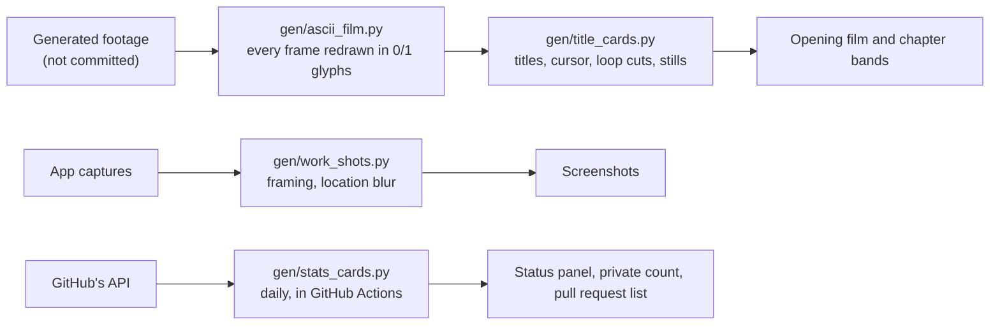

<!-- Tier 3, art-directed (docs/design/adr-readme-design-language.md). Bands come from gen/title_cards.py.
The STATS, ACTIVITY and UPSTREAM blocks are rewritten daily by gen/stats_cards.py: change the generator, not the block. -->

<a href="./assets/bands/film.webp" title="Play the uncut 15.7-second film"><picture>
  <source media="(prefers-reduced-motion: reduce)" srcset="./assets/bands/hero-still.webp">
  
</picture></a>

# Fawwaz Lawal

I build backend services in Go and iPhone apps in Swift and SwiftUI, and I spend as much
care on the checks around a system as on the system itself. I came to software through
security, where the habit of asking *"how would I know if this were wrong?"* was the whole
job. I kept the habit.

So this page is built like a check. Every chapter is stamped with how far you can verify
it, starting with the work you can open yourself.

<sub><code>PUBLIC</code> source or record one click away · <code>GENERATED</code> written daily from GitHub's API by a script in this repository, and dated · <code>SHOWN</code> a capture: it proves the software exists, not how well it works · <code>STATED</code> my own record, dated: my word, not a link</sub>

<p><code>00</code>&nbsp;<a href="#00--in-the-open-hellogitty">In&nbsp;the&nbsp;open</a> &nbsp; <code>01</code>&nbsp;<a href="#01--upstream-pull-requests-to-other-peoples-projects">Upstream</a> &nbsp; <code>02</code>&nbsp;<a href="#02--restricted-two-private-projects">Restricted</a> &nbsp; <code>03</code>&nbsp;<a href="#03--systems-how-i-work">Systems</a> &nbsp; <code>04</code>&nbsp;<a href="#04--toolkit">Toolkit</a> &nbsp; <code>05</code>&nbsp;<a href="#05--exit-check-the-record">Exit</a></p>

## 00 · In the open: HelloGitty

<sub><code>PUBLIC</code> <a href="https://github.com/FawwazLawal/hellogitty">FawwazLawal/hellogitty</a> · Go · SQLite · MIT licence · v0.2.0, released 2026-10-23</sub>

**A local dashboard for running open-source work: the issues worth taking, the pull requests
waiting on you or on a maintainer, and the health of the repositories you follow.** It polls
the GitHub API on a schedule, hourly by default, keeps everything in SQLite, and serves one
self-contained page on `localhost`, with no build step, no CDN and no external fonts. Once the
data is local, it works offline.

It stays honest about what it knows. Every poll writes `snapshot.json` beside the dashboard,
so anything downstream reads exactly what the last sweep found instead of scraping HTML.
Configuration is one JSON file, and [the guide](https://github.com/FawwazLawal/hellogitty/blob/main/docs/GUIDE.md)
covers every column, colour and cell.

<picture>
  <source media="(prefers-color-scheme: dark)" srcset="./assets/work/hellogitty-dark.webp">
  
</picture>
<p align="center"><sub><i>My own instance, shown in your GitHub theme. HelloGitty has a light and a dark mode; switch yours to see the other. The pull requests under Your move are rows from the next chapter.</i></sub></p>

```sh
go install github.com/FawwazLawal/hellogitty/cmd/hellogitty@latest
```

It needs Go 1.26 or newer and a GitHub token with public read access; the
[quick start](https://github.com/FawwazLawal/hellogitty#quick-start) takes it from there.

**Status:** public, v0.2.0. Proven: it runs, and the capture is my own instance tracking 31
repositories. Not yet shown: anyone using it but me.

<picture>
  <source media="(prefers-reduced-motion: reduce)" srcset="./assets/bands/chapter-01-upstream-still.webp">
  
</picture>

## 01 · Upstream: pull requests to other people's projects

<sub><code>PUBLIC</code> each link opens the pull request and its review · <code>GENERATED</code> states refresh daily</sub>

HelloGitty is how I run this work: it watches the repositories, I choose the issue, and the
pull request goes upstream. Most of them make a failure visible.

- **Go:** [`cmd/go`: clarify test cache behavior for file metadata](https://github.com/golang/go/pull/82377).
  The help text now says the test cache checks a file's metadata, not its content.
- **XcodeGen:** [Warn on unrecognized keys in target dictionaries](https://github.com/yonaskolb/XcodeGen/pull/1660).
  A misspelt key such as `resources` was silently ignored; now it warns.
- **Coraza:** [Document skip/skipAfter limitations under multiphase evaluation](https://github.com/corazawaf/coraza/pull/1785).
  A rule-flow behaviour of the web application firewall is now written down where people will hit it.
- **MISP:** [Return a proper REST response from the auth key pin endpoint](https://github.com/MISP/MISP/pull/11222).
  API callers get a JSON success or failure instead of a browser flash message.
- **OpenCTI:** [Fix SMTP configuration margin and empty value display](https://github.com/OpenCTI-Platform/opencti/pull/19110).
  An empty setting now shows the platform's empty-value dash instead of an empty chip.

<!-- STATS:START -->
<picture>
  <source media="(prefers-color-scheme: light)" srcset="./assets/stats-light.svg">
  
</picture>
<!-- STATS:END -->

<!-- UPSTREAM:START -->
<details>
<summary><b>All 9 pull requests and their state today</b> · 2 merged · 7 open</summary>

- `merged` [fix(ui): fix SMTP configuration margin and empty value display (\#18931)](https://github.com/OpenCTI-Platform/opencti/pull/19110) · [OpenCTI-Platform/opencti](https://github.com/OpenCTI-Platform/opencti) · 2026-10-23
- `merged` [Add Arabic-script specifics to hardening reference (\#1009)](https://github.com/pbakaus/impeccable/pull/1084) · [pbakaus/impeccable](https://github.com/pbakaus/impeccable) · 2026-10-21
- `open` [Warn on unrecognized keys in target dictionaries](https://github.com/yonaskolb/XcodeGen/pull/1660) · [yonaskolb/XcodeGen](https://github.com/yonaskolb/XcodeGen) · 2026-10-23
- `open` [audit: add RTL checks to Responsive Design dimension](https://github.com/pbakaus/impeccable/pull/1114) · [pbakaus/impeccable](https://github.com/pbakaus/impeccable) · 2026-10-22
- `open` [fix(ui): separate indicator list column values in the Knowledge tab (\#18163)](https://github.com/OpenCTI-Platform/opencti/pull/19154) · [OpenCTI-Platform/opencti](https://github.com/OpenCTI-Platform/opencti) · 2026-10-21
- `open` [cmd/go: clarify test cache behavior for file metadata](https://github.com/golang/go/pull/82377) · [golang/go](https://github.com/golang/go) · 2026-10-20
- `open` [fix: \[api\] return proper REST response from auth key pin endpoint](https://github.com/MISP/MISP/pull/11222) · [MISP/MISP](https://github.com/MISP/MISP) · 2026-10-20
- `open` [docs: document skip/skipAfter limitations under multiphase evaluation (\#804)](https://github.com/corazawaf/coraza/pull/1785) · [corazawaf/coraza](https://github.com/corazawaf/coraza) · 2026-10-19
- `open` [fix(ui): align info icon tooltips in user creation form (\#19017)](https://github.com/OpenCTI-Platform/opencti/pull/19108) · [OpenCTI-Platform/opencti](https://github.com/OpenCTI-Platform/opencti) · 2026-10-19

<sub>Verified 2026-10-24 against each project's pull request refs; from the next daily run, <code>GENERATED</code> from GitHub's API by <a href="./gen/stats_cards.py">gen/stats_cards.py</a>: every public pull request I have opened against a repository I don't own, except ones closed without merging and practice repositories.</sub>

</details>
<!-- UPSTREAM:END -->

<picture>
  <source media="(prefers-reduced-motion: reduce)" srcset="./assets/bands/chapter-02-restricted-still.webp">
  
</picture>

## 02 · Restricted: two private projects

<sub><code>SHOWN</code> captures of the apps · <code>STATED</code> figures from the private repositories, dated · source private</sub>

The two projects I spend most of my time on are in private repositories. The source stays
closed, so this chapter shows what they do and what they look like, and marks every number
as mine. GitHub can count the private work without showing it:

<!-- ACTIVITY:START -->
<code>GENERATED</code> 2026-10-24 from GitHub's API: **2,189 of my 2,375** contributions in the past year were in private repositories, by GitHub's own count.
<!-- ACTIVITY:END -->

### Fisher

<sub><code>SHOWN</code> private repository · Swift · SwiftUI · Go · in development</sub>

An iPhone client and a Go backend for the Internet Archive's public audio: a century of
concerts, broadcasts and records, much of it missing from streaming services. Playback is the
easy part. The work is making an archive this large and this uncurated feel like a music app.


Mixes are built by rule instead of by hand, and each one states the rule it was built from:
*Hip Hop Essentials* is "tagged hip hop or rap, most downloaded this week, one record an
artist, from artists a music database knows." The cover is a mosaic of the records that made
the cut. The home feed reorders itself from listening behaviour, with artist affinity and
genre weighting that decay over time, computed on the device. The player carries a written
note on the recording itself, so a 1992 record arrives with its history attached rather than
as a bare file name.

**Status:** in development, not in any app store. A Go API with background workers, a SwiftUI
client with a widget extension, and unit and UI test targets; <code>STATED</code> 629 commits
as of 2026-10-16. Not public: the source, the backend or any build.

### Domain Dispatch

<sub><code>SHOWN</code> private repository · Swift · SwiftUI · Vapor · Kotlin · alpha</sub>

A multi-modal field operations platform for teams that work where connectivity ends. It fuses
drones, vehicles, traffic cameras, aircraft, weather and mesh radios into one live operational
picture, with mission tasking, event dispatch and review workflows. macOS and iOS in Swift and
SwiftUI, a Vapor service, an Android companion. Offline first by design: it has to work at a
trailhead with no signal, and that drives nearly every architectural decision in it.


Owned assets and public infrastructure share one map. Public traffic cameras sit beside the
operator's own entities, and any camera opens in place and can be pinned to a live feed panel.
Everything assumes the link will drop: offline map packs, a sync queue that drains when the
connection returns, and a status bar that says what is connected and what is not. The basemap
is blurred in these captures, and the camera's agency badge obscured, because the console is
pointed at a real place.


Planning is a checklist with teeth. An area of operations is drawn on the map, searched by
address or taken from the current view, and assets, flight parameters, classification,
geofence and operator each have to be set before a mission can begin. Plans save and replay.
Interop is first party: Cursor-on-Target over an embedded TAK relay, MQTT, HLS video, and
multi-source fusion with explicit conflict resolution when two sources disagree about the
same entity.

The failures worth designing for are the invisible ones. An elevation lookup was caching
network failures as "no data", so an operator could plan offline, reconnect, and never get
the terrain warning back. The fix separates *checking* from *could not check* from *no
conflict*, because an absent answer that renders as "clear" fails in the dangerous direction.
The same reasoning made the terrain lookup opt in: it sends planned search area coordinates
to a third party, and that is an operator's decision, not a default.

**Status:** alpha, v0.193.0-alpha as of 2026-10-16. Pictured: the macOS app. Described but not
pictured: the iOS app, the Vapor service and the Android companion. No claim of field use.

<details>
<summary><b>Declassify the repository figures</b> · <code>STATED</code> 2026-10-16</summary>

| Domain Dispatch, private repository | Count |
|---|--:|
| Commits | 1,497 |
| Tagged releases | 189 |
| Swift modules | 7 |
| Source files | 345 |
| Third-party runtime dependencies | 0 |
| Test files | 455 |
| Tests | about 3,600 |
| Automated quality gates | 44 |
| Self-tests whose only job is to prove a gate fails when it should | 27 |
| Logged engineering incidents, each with a root cause | 550 |
| Recorded architecture decisions | 131 |

<sub>Counted from the private repository and first written here on 2026-10-16. No counting method is published, so read these as my record, not as measurements you can repeat.</sub>

</details>

<picture>
  <source media="(prefers-reduced-motion: reduce)" srcset="./assets/bands/chapter-03-systems-still.webp">
  
</picture>

## 03 · Systems: how I work

<sub><code>STATED</code> incidents and numbers from my own build notes on private projects · one <code>PUBLIC</code> trace</sub>

**A check that cannot go red is not a check.**
`go test ./...` without `-count=1` can replay a cached pass. A mutation test of mine reported
a pass on a test that had never run, and 1 of 25 mutants came back falsely green. I now show
a check failing against the broken state before I trust it passing. The public trace: the
cache checks file metadata, not content, and [I'm documenting that in Go's own help text](https://github.com/golang/go/pull/82377).

**Detectors stop defect classes. Rules do not.**
Of thirteen recurring defect classes in my own build process, the only two that ever stopped
were stopped by an automated check, not by a rule everyone had agreed to. I build the
detector first.

**Replace the proxy with the act.**
`git check-ignore -v` exits 0 when any pattern matches, including a negating one, so a
perfectly committable file reports as ignored. `git add --dry-run` is the operation itself.
A check should measure the thing you care about, not a predicate about it.

**Audit by computation, not by eye.**
I audited a design system for WCAG AA by computing the contrast ratios instead of trusting the
documented values. One token passed by 0.0008. Another failed outright and had zero usages,
so I deleted it rather than fixing it: an unused failing token is a trap for the next person.

**Measure before you claim.**
"It builds" means it ran this session and exited 0. Every number says how it was measured.
Reading is a hypothesis, running is a finding, and I say which one I have. This page follows
the same rule, which is why every chapter carries a stamp.

### Working with agents

My day-to-day development runs through a program of roughly thirty specialised Claude Code
agents: builders, QA, composition review, release. The agents were the easy part. The work
was building the instruments that keep them honest: detection for two agents about to write
the same file, for gates that cannot fail, and for records claiming more certainty than they
have.

<picture>
  <source media="(prefers-reduced-motion: reduce)" srcset="./assets/bands/chapter-04-toolkit-still.webp">
  
</picture>

## 04 · Toolkit

<sub><code>STATED</code> no verification links are published for these. Go, Python and GitHub Actions can be read in public code: HelloGitty, and the scripts behind this page.</sub>

- **Languages:** Go · Swift · Python · Kotlin
- **Apple:** SwiftUI · Xcode
- **Delivery:** Docker · GitHub Actions
- **Security work:** OpenCTI · MISP · Coraza, through the [pull requests above](#01--upstream-pull-requests-to-other-peoples-projects)
- **Background:** B.S. Cybersecurity · B.S. Electrical Engineering, in progress
- **Certifications:** Security+ · CySA+ · PenTest+ · ISC2 Associate

<details>
<summary><b>How this page is built</b></summary>

Everything here that moves or updates comes out of a script in this repository, so it can be
rebuilt and checked rather than taken on trust.



The opening film is a 4.7-second loop; every band has a still for readers who ask their
system for reduced motion. A failed daily run leaves the last panel and list in place, with
their old date.

</details>

<picture>
  <source media="(prefers-reduced-motion: reduce)" srcset="./assets/bands/chapter-05-exit-still.webp">
  
</picture>

## 05 · Exit: check the record

- **Run it.** [HelloGitty](https://github.com/FawwazLawal/hellogitty) installs with one `go install` and runs on your machine.
- **Follow it upstream.** [My pull requests to other people's projects](https://github.com/search?q=is%3Apr+is%3Apublic+author%3AFawwazLawal+-user%3AFawwazLawal&type=pullrequests&s=created&o=desc), live on GitHub, newest first.
- **Read the code.** My [public repositories, with forks hidden](https://github.com/FawwazLawal?tab=repositories&type=source).
- **Watch the whole shot.** The opening film runs 4.7 seconds here; [the uncut 15.7-second version](./assets/bands/film.webp) opens when you click it.

<p align="center"><code>&gt; end of transmission</code></p>

<p align="center"><sub>The hero is footage generated with Google Flow. Every band is rendered into 0/1 glyphs frame by frame by <a href="./gen/ascii_film.py">gen/ascii_film.py</a> and titled by <a href="./gen/title_cards.py">gen/title_cards.py</a>. Work captures are framed by <a href="./gen/work_shots.py">gen/work_shots.py</a>. The status panel, the private count and the pull request list regenerate daily through <a href="./gen/stats_cards.py">gen/stats_cards.py</a>.</sub></p>
