<picture>
  <source media="(prefers-reduced-motion: reduce)" srcset="./assets/hero-band-still.png">
  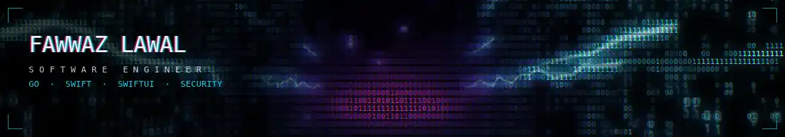
</picture>

I build backend services in Go and iPhone apps in Swift and SwiftUI, and I spend as much
care on the checks around a system as on the system itself. I came to software through
security, where the habit of asking "how would I know if this were wrong?" was the whole
job. I kept the habit.

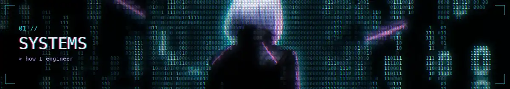

### How I work

**A check that cannot go red is not a check.**
`go test` without `-count=1` reads the cache. A mutation test of mine reported a pass on a
test that had never run, and 1 of 25 mutants came back falsely green. I now show a check
failing against the broken state before I trust it passing.

**Detectors stop defect classes. Rules do not.**
Of thirteen recurring defect classes in my own build process, the only two that ever stopped
were stopped by an automated check, not by a rule everyone had agreed to. I build the
detector first.

**Replace the proxy with the act.**
`git check-ignore` exits 0 when any pattern matches, including a negating one, so a perfectly
committable file reports as ignored. `git add --dry-run` is the operation itself. A check
should measure the thing you care about, not a predicate about it.

**Audit by computation, not by eye.**
I audited a design system for WCAG AA by computing the contrast ratios instead of trusting the
documented values. One token passed by 0.0008. Another failed outright and had zero usages,
so I deleted it rather than fixing it: an unused failing token is a trap for the next person.

**Measure before you claim.**
"It builds" means it ran this session and exited 0. Every number says how it was measured.
Reading is a hypothesis, running is a finding, and I say which one I have.

### Working with agents

My day-to-day development runs through a program of roughly thirty specialised Claude Code
agents: builders, QA, composition review, release. They coordinate over a file-based message
bus with lane ownership, a handoff protocol, and gated task promotion.

The agents were the easy part. The work was building the instruments that keep them honest:
detection for two agents about to write the same file, for gates that cannot fail, and for
records claiming more certainty than they have.

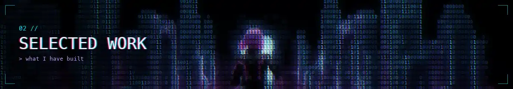

### [Speed-to-lead](https://github.com/FawwazLawal/blaze-speed-to-lead)

`Python` `FastAPI` `Supabase` `Discord`

A lead-ad form submission becomes a scored, personalised reply in Discord a few seconds
later, against a 22-hour human baseline. One webhook, one database row, one structured
model call, one card. Three consecutive live runs measured end to end: 4.8s, 5.0s, 3.0s.

The part I care about is the honesty of the seam. Facebook itself is simulated, and the
README says exactly where simulation stops and real infrastructure starts. The model's reply
is parsed against a schema so a malformed response raises instead of reaching a human, and
the prompt is read from disk at runtime so the file in the repo is exactly what gets sent.

### Public repositories

<!-- REPOS:START -->

<a href="https://github.com/FawwazLawal/blaze-speed-to-lead"></a>
<a href="https://github.com/FawwazLawal/VS-Code-Notes-By-Fawwaz-Lawal"></a>
<a href="https://github.com/FawwazLawal/Moderate-Calculator-Demo-By-Fawwaz-Lawal"></a>
<a href="https://github.com/FawwazLawal/Basic-Calculator-Demo-by-Fawwaz-Lawal"></a>

<!-- REPOS:END -->

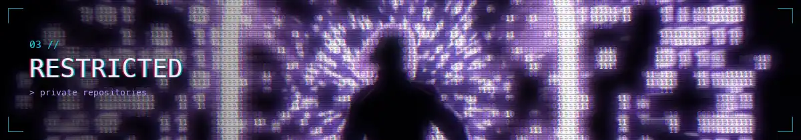

The two projects I spend most of my time on are in private repositories. The source stays
closed, so this is what they do and what they look like.

### Fisher

`Swift` `SwiftUI` `Go` `private repository`

An iPhone client and a Go backend for the Internet Archive's public audio: a century of
concerts, broadcasts and records that no streaming service carries. Playback is the easy
part. The work is making an archive this large and this uncurated feel like a music app.

Mixes are built by rule instead of by hand, and each one states the rule it was built from:
Hip Hop Essentials is "tagged hip hop or rap, most downloaded this week, one record an
artist, from artists a music database knows." The cover is a mosaic assembled from the
records that made the cut. The home feed reorders itself from listening behaviour, with
artist affinity and genre weighting that decays over time, computed on the device. The
player carries a written note on the recording itself, so a 1992 record arrives with its
history attached rather than as a bare file name.

A Go API with background workers, a SwiftUI client with a widget extension, and unit and UI
test targets. 629 commits, in development, not in any app store.

### Domain Dispatch

`Swift` `Kotlin` `Go` `private repository`

A macOS console that holds one live picture of a drone operation: aircraft, vehicles,
cameras, radios and public feeds on a single map, with tasking, live tracking and
after-action review.

Owned assets and public infrastructure share one map. Above, public traffic cameras sit
beside the operator's own entities, and any camera opens in place and can be pinned to a
live feed panel. Everything assumes the link will drop: offline map packs, a sync queue that
drains when the connection returns, and a status bar that stays honest about what is
connected and what is not.

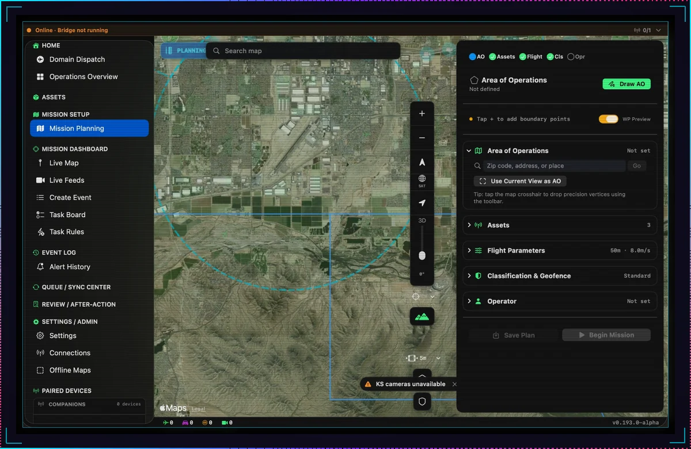

Planning is a checklist with teeth. An area of operations is drawn on the map, searched by
address or taken from the current view, and assets, flight parameters, classification,
geofence and operator each have to be set before a mission can begin. Plans save and replay.

A Swift app with an Android companion for paired devices, its own backend and a telemetry
service. 1,497 commits, currently at v0.193.0-alpha.

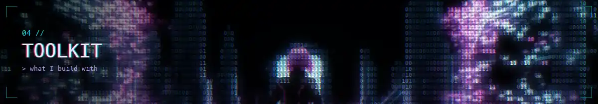

| | |
|---|---|
| **Languages** | Go · Swift · Python · Kotlin |
| **Apple** | SwiftUI · Xcode |
| **Delivery** | Docker · GitHub Actions |
| **Background** | B.S. Cybersecurity · B.S. Electrical Engineering, in progress |
| **Certifications** | Security+ · CySA+ · PenTest+ · ISC2 Associate |

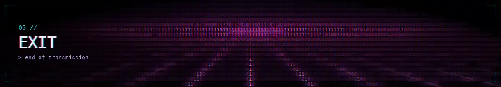

<code>&gt; end of transmission. the rest of the work is in <a href="https://github.com/FawwazLawal?tab=repositories">repositories</a>.</code>

Hero footage generated with Google Flow, then cut and rendered into 0/1 glyphs frame by frame by <a href="./gen/ascii_film.py">gen/ascii_film.py</a>. The chapter bands are short loops from the same footage. Screenshots of the private work are framed by <a href="./gen/work_shots.py">gen/work_shots.py</a>. Stats and repository cards are regenerated daily by <a href="./gen/stats_cards.py">gen/stats_cards.py</a>.

