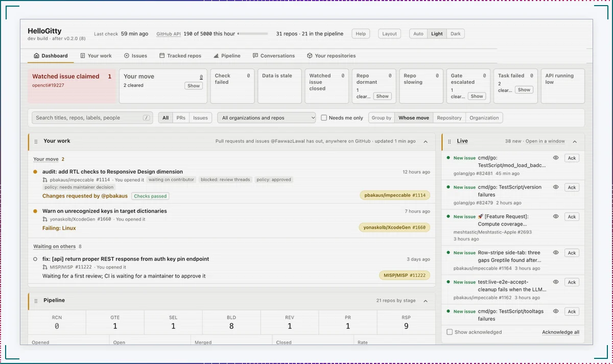
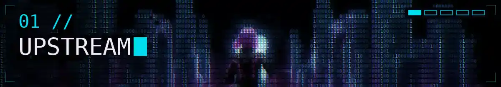
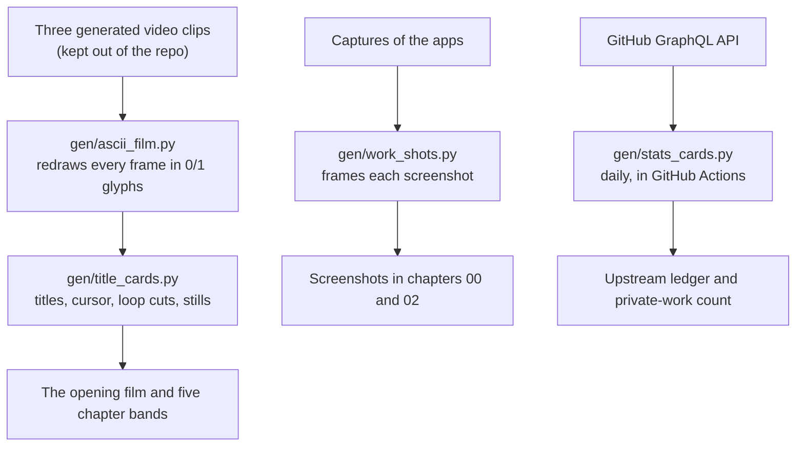

<!--
Tier 3, art-directed (docs/design/adr-readme-design-language.md).
One continuous shot: she looks back in the hero, runs, is stopped at a scanner, works,
arms herself, and leaves through the gateway in chapter 05. The film carries identity;
every claim is real text, marked PUBLIC, GENERATED or SELF-REPORTED.
Bands: assets/bands/, made by gen/title_cards.py from assets/originals/. One moving band per
screen; each has a reduced-motion still. The STATS and UPSTREAM blocks are rewritten daily
by gen/stats_cards.py: change the generator, not the block.
-->

<a href="./assets/bands/film.webp" title="Play the uncut 15.7-second film"><picture>
  <source media="(prefers-reduced-motion: reduce)" srcset="./assets/bands/hero-still.webp">
  
</picture></a>

# Fawwaz Lawal

I'm a software engineer who builds backend services in Go and native apps in Swift, and the checks that tell me when they are wrong.

I came to software through security, where the whole job was asking *"how would I know if this were wrong?"* I kept the habit. I spend as much care on the checks around a system as on the system itself, so this page is built the same way: every chapter is marked with how far you can verify it. Start with the two you can check yourself.

- **00 · [In the open](#built-in-the-open-hellogitty).** HelloGitty, a Go dashboard you can install and run. `PUBLIC`
- **01 · [Upstream](#upstream-pull-requests-to-other-peoples-projects).** My pull requests to other people's projects, merged or not. `PUBLIC` `GENERATED`
- **02 · [Restricted](#restricted-two-private-projects).** Fisher and Domain Dispatch, the private work. `SELF-REPORTED`
- **03 · [Systems](#systems-how-i-work).** How I work, from my own build notes. `SELF-REPORTED`
- **04 · [Toolkit](#toolkit-what-i-build-with).** Languages, credentials, and the scripts that build this page. `PUBLIC` `SELF-REPORTED`
- **05 · [Exit](#exit-where-the-work-continues).** Where the work continues.

<sub>`PUBLIC`: open the source or the record yourself. `GENERATED`: rewritten daily from GitHub's API by a script in this repository, and dated. `SELF-REPORTED`: my own account of private work, with a date on every number.</sub>

## Built in the open: HelloGitty

<sub>`PUBLIC` source, install command and changelog are on GitHub.</sub>

A local dashboard for tracking contribution opportunities across repositories you choose: open issues, good-first-issues, maintainer activity, repo health, and pull requests that were closed without merging and why. It polls the GitHub API on a schedule, stores everything in SQLite, and serves one self-contained page on localhost, with no front-end build step, no CDN and no external fonts. It works offline once the data is local.

Every poll writes a machine-readable snapshot alongside the dashboard, so anything downstream can read exactly what the last sweep found rather than scraping HTML. Configuration is one JSON file. A guide to every column, colour and cell is in [docs/GUIDE.md](https://github.com/FawwazLawal/hellogitty/blob/main/docs/GUIDE.md).

<picture>
  <source media="(prefers-color-scheme: dark)" srcset="./assets/work/hellogitty-dark.webp">
  
</picture>

<sub>*Shown in your GitHub theme: switch GitHub between light and dark and the capture switches with it, using HelloGitty's own two modes. Captured in October 2026 from a dev build after v0.2.0. The "Your work" panel is my real queue: the same pull requests appear in the ledger below.*</sub>

Install it with Go 1.26 or newer, then follow the five-step [quick start](https://github.com/FawwazLawal/hellogitty#quick-start): a read-only token, one JSON file listing the repositories you follow, and `localhost:7340`.

```sh
go install github.com/FawwazLawal/hellogitty/cmd/hellogitty@latest
```

**Status:** public, [v0.2.0](https://github.com/FawwazLawal/hellogitty/blob/main/CHANGELOG.md) (2026-10-23). It runs on your own machine and listens on loopback only; it is not a hosted service.

<picture>
  <source media="(prefers-reduced-motion: reduce)" srcset="./assets/bands/chapter-01-upstream-still.webp">
  
</picture>

## Upstream: pull requests to other people's projects

<sub>`PUBLIC` `GENERATED` every pull request links to itself; states refresh daily.</sub>

These are the changes I've sent to projects I don't own. Most are small, and the list gives each one's state and date, merged or not. In security tooling: three interface fixes for OpenCTI, a REST response fix for MISP's auth-key pin endpoint, and documentation for Coraza's skip actions under multiphase evaluation. Elsewhere: clearer `go help test` text about how Go's test cache detects changed files, a spec-validation warning for XcodeGen that catches typos such as `resources` for `sources`, Arabic-script guidance and right-to-left audit checks for impeccable, and `q`-value handling for gzip in HAPI FHIR.

<!-- UPSTREAM:START -->
- `merged 2026-10-23` [fix(ui): fix SMTP configuration margin and empty value display (#18931)](https://github.com/OpenCTI-Platform/opencti/pull/19110) · OpenCTI-Platform/opencti
- `merged 2026-10-21` [Add Arabic-script specifics to hardening reference (#1009)](https://github.com/pbakaus/impeccable/pull/1084) · pbakaus/impeccable
- `open since 2026-10-23` [Warn on unrecognized keys in target dictionaries](https://github.com/yonaskolb/XcodeGen/pull/1660) · yonaskolb/XcodeGen
- `open since 2026-10-22` [audit: add RTL checks to Responsive Design dimension](https://github.com/pbakaus/impeccable/pull/1114) · pbakaus/impeccable
- `open since 2026-10-21` [fix(ui): separate indicator list column values in the Knowledge tab (#18163)](https://github.com/OpenCTI-Platform/opencti/pull/19154) · OpenCTI-Platform/opencti
- `open since 2026-10-20` [cmd/go: clarify test cache behavior for file metadata](https://github.com/golang/go/pull/82377) · golang/go
- `open since 2026-10-20` [fix: \[api\] return proper REST response from auth key pin endpoint](https://github.com/MISP/MISP/pull/11222) · MISP/MISP
- `open since 2026-10-19` [docs: document skip/skipAfter limitations under multiphase evaluation (#804)](https://github.com/corazawaf/coraza/pull/1785) · corazawaf/coraza
- `open since 2026-10-19` [fix(ui): align info icon tooltips in user creation form (#19017)](https://github.com/OpenCTI-Platform/opencti/pull/19108) · OpenCTI-Platform/opencti
- `state unconfirmed` [Fix gzip Accept-Encoding quality parameter handling](https://github.com/hapifhir/hapi-fhir/pull/8530) · hapifhir/hapi-fhir
- `closed without merge` [test: port PySpark Catalog.listFunctions doctest](https://github.com/lakehq/sail/pull/2821) · lakehq/sail

<sub>2 merged · 7 open · 1 closed without merge · 1 unconfirmed. Seeded 2026-10-24 from independently checked pull requests; from the next run, rewritten daily by <a href="./gen/stats_cards.py">gen/stats_cards.py</a> from GitHub's search API. Every public pull request I've opened against a repository I don't own is listed, except one line added to a contributor-practice list.</sub>
<!-- UPSTREAM:END -->

<picture>
  <source media="(prefers-reduced-motion: reduce)" srcset="./assets/bands/chapter-02-restricted-still.webp">
  
</picture>

## Restricted: two private projects

<sub>`SELF-REPORTED` screenshots of the apps; source private; every figure dated. One count below is `GENERATED` by GitHub.</sub>

The two projects I spend most of my time on live in private repositories. The source stays closed, so this chapter shows what they do and what they look like, and marks every number as mine. GitHub can count the private work without showing it:

<!-- STATS:START -->
**2,189 of 2,363** contributions in the past year were made in private repositories, by GitHub's own count. Public commits in the same year: **108**.<br>
<sub>Synced 2026-10-23 from GitHub's GraphQL API by <a href="./gen/stats_cards.py">gen/stats_cards.py</a>, daily. If a sync fails, this date stops moving.</sub>
<!-- STATS:END -->

### Fisher

`Swift` `SwiftUI` `Go`

An iPhone client and a Go backend for the Internet Archive's public audio: a century of concerts, broadcasts and records, many of them on no streaming service. Playback is the easy part. The work is making an archive this large and this uncurated feel like a music app.


<sub>*Three screens from the app, framed by <a href="./gen/work_shots.py">gen/work_shots.py</a>.*</sub>

Mixes are built by rule, not by hand, and each one states the rule it was built from. *Hip Hop Essentials* is "tagged hip hop or rap, most downloaded this week, one record an artist, from artists a music database knows." The cover art is a mosaic assembled from the records that made the cut. The home feed reorders from listening behaviour, with artist affinity and genre weighting that decay over time, computed entirely on-device. The player carries a written note on the recording itself, so a 1992 record arrives with its history attached rather than as a bare file name.

**Status:** in development; not in any app store. Built as a Go API with background workers and a SwiftUI client with a widget extension, with unit and UI test targets; 629 commits as of 2026-10-16. Shown here: three screens. Not public: the source, the backend or any build.

### Domain Dispatch

`Swift` `SwiftUI` `Vapor` `Kotlin`

A multi-modal field operations platform designed for work where connectivity ends. It fuses drones, vehicles, traffic cameras, aircraft, weather and mesh radios into one live operational picture, with mission tasking, event dispatch and review workflows: macOS and iOS in Swift and SwiftUI, a Vapor service, an Android companion. Offline-first by design. It has to work at a trailhead with no signal, and that drives nearly every architectural decision.


<sub>*The macOS app. The basemap is blurred and the camera's agency badge obscured, because the console is pointed at a real place.*</sub>

Owned assets and public infrastructure share one map. Public traffic cameras sit beside the operator's own entities, and any camera opens in place and can be pinned to a live feed panel. Everything assumes the link will drop: offline map packs, a sync queue that drains when the connection returns, and a status bar that stays honest about what is connected and what is not.


<sub>*Mission planning, macOS. Same redactions.*</sub>

Planning is a checklist with teeth. An area of operations is drawn on the map, searched by address, or taken from the current view. Assets, flight parameters, classification, geofence and operator each have to be set before a mission can begin. Plans save and replay. Interop is first party: Cursor-on-Target over an embedded TAK relay, MQTT, HLS video, and multi-source fusion with explicit conflict resolution when two sources disagree about the same entity.

The failures worth designing for are the invisible ones. An elevation lookup was caching network failures as "no data", so an operator could plan offline, reconnect, and never get the terrain warning back. The fix separates *checking* from *could not check* from *no conflict*, because an absent answer that renders as "clear" fails in the dangerous direction. The same reasoning made the terrain lookup opt-in: it sends planned search area coordinates to a third party, and that is an operator's decision, not a default.

**Status:** alpha, v0.193.0-alpha as of 2026-10-16. Pictured: the macOS app. Described but not pictured: the iOS app, the Vapor service and the Android companion.

<details>
<summary><b>Declassify the repository figures</b> <sub>(self-reported, 2026-10-16)</sub></summary>

| Domain Dispatch, private repository | Count |
|---|--:|
| Commits | 1,497 |
| Tagged releases | 189 |
| Swift modules | 7 |
| Source files | 345 |
| Third-party runtime dependencies | 0 |
| Test files | 455 |
| Tests | about 3,600 |
| Automated quality gates | 44 |
| Self-tests whose only job is to prove a gate fails when it should | 27 |
| Logged engineering incidents, each with a root cause | 550 |
| Recorded architecture decisions | 131 |

<sub>Entered by hand on 2026-10-16 and not updated since. The repository is private, so none of these can be checked from here.</sub>

</details>

<picture>
  <source media="(prefers-reduced-motion: reduce)" srcset="./assets/bands/chapter-03-systems-still.webp">
  
</picture>

## Systems: how I work

<sub>`SELF-REPORTED` incidents and numbers from my own build notes on private projects; one `PUBLIC` link.</sub>

Five rules I hold myself to, most with the incident that taught me.

### A check that cannot go red is not a check

A mutation test of mine reported a pass on a test that had never run: `go test ./...` without `-count=1` can replay a cached result, and 1 of 25 mutants came back falsely green. I now show a check failing against the broken state before I trust it passing. Since then I've proposed clearer wording for Go's own help text on how the test cache decides a file has changed ([golang/go#82377](https://github.com/golang/go/pull/82377)).

### Detectors stop defect classes. Rules do not.

Of thirteen recurring defect classes in my own build process, the only two that ever stopped were stopped by an automated check, not by a rule everyone had agreed to. I build the detector first.

### Replace the proxy with the act

`git check-ignore -v` exits 0 when any pattern matches, including a negating one, so a perfectly committable file can look ignored. `git add --dry-run` is the operation itself. A check should measure the thing you care about, not a predicate about it.

### Audit by computation, not by eye

I audited a design system for WCAG AA by computing the contrast ratios instead of trusting the documented values. One token passed by 0.0008. Another failed outright and had zero usages, so I deleted it rather than fixing it: an unused failing token is a trap for the next person.

### Measure before you claim

"It builds" means it ran this session and exited 0. Every number says where it came from. Reading is a hypothesis, running is a finding, and I say which one I have. This page follows the same rule, which is why its chapters carry markings.

### Working with agents

My day-to-day development runs through roughly thirty specialised Claude Code agents: builders, QA, composition review, release. The agents were the easy part. The work was building the instruments that keep them honest: detection for two agents about to write the same file, for gates that cannot fail, and for records claiming more certainty than they have.

<picture>
  <source media="(prefers-reduced-motion: reduce)" srcset="./assets/bands/chapter-04-toolkit-still.webp">
  
</picture>

## Toolkit: what I build with

<sub>`PUBLIC` the scripts that build this page are in this repository. `SELF-REPORTED` languages and credentials.</sub>

### What I work in

- **Languages:** Go · Swift · Python · Kotlin
- **Apple:** SwiftUI · Xcode
- **Security, upstream:** OpenCTI · MISP · Coraza, through the [pull requests above](#upstream-pull-requests-to-other-peoples-projects)
- **Delivery:** Docker · GitHub Actions
- **Background:** B.S. Cybersecurity · B.S. Electrical Engineering (in progress)
- **Certifications:** CompTIA Security+ · CySA+ · PenTest+ · ISC2 Associate

Go and Python are the ones you can read in public: HelloGitty, and the scripts below. Swift and Kotlin live in the private work, and the credentials have no public verification link here.

### How this page is built

Everything on this page that moves or updates comes out of a script in this repository, so it can be rebuilt and checked rather than taken on trust.



<sub>*If the diagram doesn't render, here it is in words: footage to glyph film to titled bands; app captures to framed screenshots; GitHub's API to the daily ledger and count.*</sub>

Two of the four run from a clone. The first rebuilds every band, still and the full film from the renders kept in `assets/originals/`; the second rewrites the ledger and the count, as GitHub Actions does every day at 06:17 UTC.

```sh
python3 gen/title_cards.py
GITHUB_TOKEN=... python3 gen/stats_cards.py
```

<picture>
  <source media="(prefers-reduced-motion: reduce)" srcset="./assets/bands/chapter-05-exit-still.webp">
  
</picture>

## Exit: where the work continues

The transmission ends here. The work doesn't, and all of it that's public is one click away:

- **Run it.** [HelloGitty](https://github.com/FawwazLawal/hellogitty) installs with one `go install` and runs on your machine.
- **Follow it upstream.** [My pull requests to other people's projects](https://github.com/search?q=is%3Apr+is%3Apublic+author%3AFawwazLawal+-user%3AFawwazLawal&type=pullrequests&s=created&o=desc), live on GitHub, newest first.
- **Watch the whole shot.** The opening film runs 4.7 seconds here; [the uncut 15.7-second version](./assets/bands/film.webp) opens in GitHub's file viewer, or click the film at the top.

<p align="center"><code>&gt; end of transmission.</code></p>

<p align="center"><sub>Footage generated with Google Flow, cut and rendered into 0/1 glyphs frame by frame by <a href="./gen/ascii_film.py">gen/ascii_film.py</a>, titled by <a href="./gen/title_cards.py">gen/title_cards.py</a>. Screenshots framed by <a href="./gen/work_shots.py">gen/work_shots.py</a>. Ledger and count regenerated daily by <a href="./gen/stats_cards.py">gen/stats_cards.py</a>.</sub></p>
